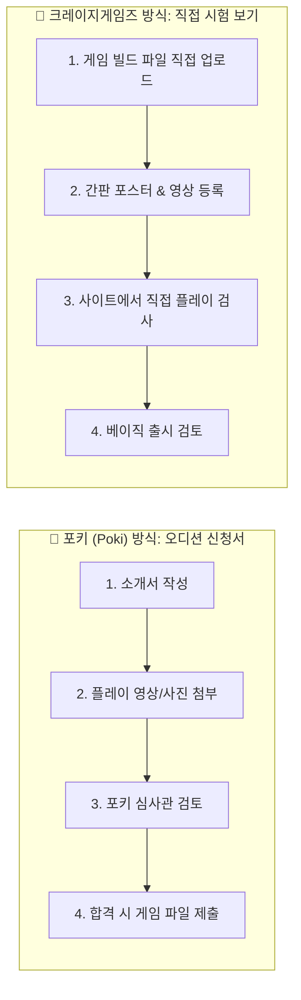

# 🎮 [초등학생도 3분 만에 이해하는] Poki & CrazyGames 게임 출시 완벽 가이드

> **"대표님, 충성! 코다리 부장입니다!"**  
> 전 세계 수천만 명의 친구들이 매일 들어와서 노는 초대형 웹게임 놀이터, **포키(Poki)**와 **크레이지게임즈(CrazyGames)**!  
> 복잡하고 머리 아픈 개발 용어는 싹 걷어내고, **초등학생도 오늘 바로 따라 할 수 있게 1부터 10까지 찰떡같이 정리**했습니다!

---

## 0. 30초 핵심 요약: "두 오락실은 들어가는 방법이 달라요!"

우리가 만든 게임 **`Reverse Boss Runner`**(용사를 막는 악마 보스 러너)를 오락실에 올리는 방법은 딱 두 가지입니다.



* **📮 포키(Poki) = "오디션 참가 신청 방식"**  
  게임 파일(ZIP)을 무작정 보내는 게 아니라, **"저 이런 재미난 게임 만들었어요!"** 하고 **맛보기 영상과 사진 3장**을 먼저 보여주는 방식입니다. 포키 본사 선생님들이 보고 "오! 재미있겠는데? 정식 파일 보내봐!" 하면 그때 게임을 올립니다.
* **🚀 크레이지게임즈(CrazyGames) = "직접 시험 보기 방식"**  
  개발자 사이트에 게임 빌드 파일과 간판 포스터·영상을 올리고, 사이트 안에서 직접 게임을 플레이해보며 자체 테스트(QA)를 치르는 방식입니다. 현재 확인한 업로드 화면은 ZIP 아카이브를 지원하지 않는다고 안내하므로 빌드 파일을 직접 올립니다.

---

## 1. 🎒 가방 챙기기 (제출할 때 꼭 필요한 보물 4총사)

출발하기 전에 가방에 다음 4가지 보물이 들어있는지 확인하세요!

| 보물 아이템 | 파일 이름 / 준비물 | 어디에 쓰나요? | 초등학생용 꿀팁 |
|---|---|---|---|
| 📦 **1. 게임 빌드 파일** | CrazyGames: `crazygames-upload/` 안의 압축되지 않은 빌드 파일 | 포털에서 게임을 실행하는 파일 | 현재 CrazyGames 업로드 화면은 ZIP을 지원하지 않는다고 안내해요. |
| 🖼️ **2. 오락실 간판 포스터** | `crazygames-cover-landscape-v3-1920x1080.png`<br>`crazygames-cover-portrait-v3-800x1200.png`<br>`crazygames-cover-square-v3-800x800.png`<br>`poki-thumbnail-v3-1254x1254.png` | 친구들이 누르고 싶게 만드는 멋진 게임 포스터 | CrazyGames는 가로·세로·네모 3종을 각각 올려요. |
| 🎬 **3. 플레이 미리보기 영상** | `crazygames-preview-landscape-v2-1920x1080.mp4`<br>`crazygames-preview-portrait-v3-1080x1620.mp4`<br>`poki-animated-preview-v3-1080x1080.mp4` | 실제 플레이와 게임 분위기를 보여주는 짧은 영상 | CrazyGames 영상 2종은 무음이며 세로 영상은 1080×1620이에요. 가로 v2는 최신 커버와 첫 프레임이 맞는지 다시 확인해야 해요. |
| 📸 **4. 게임 사진 3장** | 실제 플레이 스크린샷 3장 | "이 게임 진짜 재미있어요!" 증명 사진 | 포키 신청서에 필수! 보스와 싸우는 장면 등을 찰칵 찍어둬요. |

---

## 2. 📮 실전 1: 포키(Poki)에 내 게임 자랑하기 (신청서 쓰기)

* 🌐 **신청서 작성하는 곳:** [Poki 게임 제출 공식 페이지](https://developers.poki.com/guide/share)

### 📌 따라하기 5단계:
1. **내 정보 적기**: 이름, 이메일, 우리 팀 이름을 적어요.
2. **게임 이름 적기**: Game Title 칸에 **`Reverse Boss Runner`** 라고 적어요.
3. **게임 소개 한 줄 쓰기 (영어)**:
   > *"You play as the mighty Demon Boss placing deadly traps to defeat invading heroes in a reverse dungeon runner!"*  
   > *(해석: 무시무시한 악마 보스가 되어 침입한 용사들을 함정으로 물리치는 리버스 던전 러너 게임입니다!)*
4. **게임 엔진 고르기**: **Phaser / HTML5 / React Web** 계열을 선택해요.
5. **게임 주소 or 플레이 영상 링크 넣기**:
   - ⚠️ **주의!** `http://localhost:5173` 같은 내 컴퓨터 주소는 적으면 안 돼요! (포키 직원이 누르면 에러가 나요.)
   - 인터넷에 누구나 들어갈 수 있게 올려둔 사이트 주소나, 유튜브 영상 링크를 넣어야 해요.
6. **플레이 사진(스크린샷) 3장 첨부하기**:
   - 게임 안에서 첫 함정을 놓는 장면
   - 영웅이 함정에 걸려 넘어지는 장면
   - 보스가 거대한 공격을 피하는 장면 등 서로 다른 멋진 사진 3장을 올려요.
7. **"Why do you think your game is a good fit for Poki?" (왜 포키에 잘 어울리나요?)**:
   - 👉 **그대로 복사해서 붙여넣기 (추천 영문)**:
     > `Reverse Boss Runner flips the classic runner formula by putting players in the boots of the Boss, strategically placing traps to stop incoming heroes. It has instant pick-up-and-play appeal, fast-paced arcade action, and intuitive controls that perfectly match Poki players who love quick, satisfying, and highly replayable web games.`
   - 💡 *(초등학생용 해석: "기존 러너 게임과 반대로 보스가 되어 영웅을 막는 신선한 게임이에요! 1초 만에 룰을 배우고 바로 할 수 있어서, 빠르고 재미있는 웹게임을 좋아하는 포키 친구들에게 딱 맞아요!")*
8. **"Where is the game already available?" (이미 출시된 곳이 있나요?)**:
   - 아직 출시 안 된 새 게임이라면: `Not published yet (New release)` 또는 `None` 선택/입력!
9. **[Submit your game] 초록색 버튼 쾅 누르기!**
   - 접수가 끝나면 포키 팀에서 이메일로 연락이 올 때까지 며칠 동안 두근두근 기다리면 됩니다!

---

## 3. 🚀 실전 2: 크레이지게임즈(CrazyGames)에 파일 올리고 시험 치기

* 🌐 **개발자 사이트:** [CrazyGames Developer Portal](https://developer.crazygames.com/)

크레이지게임즈는 처음에 누구나 도전할 수 있는 **"기본 출시(Basic Launch)"**로 시작합니다!

### 📌 따라하기 6단계:
1. **로그인하고 [Submit my game] 버튼 누르기**
2. **게임 빌드 파일 올리기 (HTML5 Game File)**:
   - 최신 프로덕션 빌드의 `index.html` 및 참조 파일을 업로드 영역에 직접 끌어다 놓아요.
   - 업로드 화면에 “Archive files are not supported”라고 표시됐으므로 ZIP 파일은 올리지 말고 먼저 압축을 풀어요. 개발 소스와 `node_modules`는 올리지 않아요.
3. **간판 포스터 3총사 제자리에 넣기**:
   - 📺 가로 간판 칸: `crazygames-cover-landscape-v3-1920x1080.png`
   - 📱 세로 간판 칸: `crazygames-cover-portrait-v3-800x1200.png`
   - ⏹️ 네모 간판 칸: `crazygames-cover-square-v3-800x800.png`
4. **가로·세로 플레이 영상 올리기**:
   - 세로 최신본은 `crazygames-preview-portrait-v3-1080x1620.mp4`예요. 가로 v2 영상은 최신 가로 커버가 첫 화면인지 확인한 뒤 올리거나 새로 만들어요.
5. **미리보기(Preview)로 직접 플레이해보기 (★가장 중요!)**:
   - 화면에 뜨는 **[Preview]** 버튼을 누르면 브라우저 안에서 우리 게임이 켜져요.
   - 첫 시작 화면이 잘 나오는지?
   - 마우스로 함정이 잘 깔리고 게임이 안 튕기는지 직접 1판 플레이해봐요!
6. **[QA Checklist] 점검하고 [Submit] 누르기**:
   - 글자가 밖으로 삐져나가지 않는지, 에러 화면이 안 뜨는지 확인하고 최종 제출 버튼을 눌러요!
7. **합격 후에는?**:
   - 심사를 통과하면 **최소 7일 동안 전 세계 500명 이상의 친구들**이 내 게임을 플레이해요! 반응이 엄청 좋으면 CrazyGames에서 "메인 대박 게임으로 모시겠습니다!" 하고 정식 제안이 옵니다.

---

## 4. ⚠️ "선생님한테 혼나요!" 절대 하면 안 되는 실수 4가지

1. ❌ **내 방 컴퓨터 주소(`localhost`)를 링크로 적는 실수**  
   - 내 컴퓨터에서만 열리고, 미국이나 유럽에 있는 심사관 컴퓨터에선 안 열려요! 누구나 열 수 있는 인터넷 주소를 적어야 해요.
2. ❌ **옛날 압축파일을 올리는 실수**  
   - 예전에 버려둔 파일(`archive/` 폴더 안의 파일)을 올리면 옛날 버그가 그대로 나와서 바로 불합격돼요!
3. ❌ **간판 포스터에 거짓말이나 쓸데없는 글자 넣기**  
   - 포스터에 "1위 게임!", "무료 다운로드!", "지금 클릭!" 같은 낚시성 문구나 버튼을 그려 넣으면 심사에서 퇴짜를 맞아요. 오직 **멋진 게임 제목과 캐릭터 그림만** 넣어야 해요.
4. ❌ **가짜 사진이나 남의 게임 사진 올리기**  
   - 반드시 우리 게임을 실제로 플레이하면서 직접 캡처한 스크린샷이어야 해요.

---

## 5. 📋 마지막 숙제 검사표 (출시 버튼 누르기 직전 체크리스트)

마우스를 누르기 전에 체크박스에 하나씩 동그라미를 쳐보세요!

- [ ] 📦 오늘 만든 최신 `boss-reverse-runner.zip` 보물상자를 골랐나요?
- [ ] 🚫 옛날 구버전 파일(`archive/` 폴더)은 실수로라도 건드리지 않았나요?
- [ ] 📸 포키에 보여줄 진짜 게임 플레이 사진 3장을 준비했나요?
- [ ] 🔗 포키 신청서에 적은 주소가 로그인 없이도 누구에게나 잘 열리나요?
- [ ] 🖼️ 크레이지게임즈용 간판 포스터 3총사(가로, 세로, 네모)를 제자리에 넣었나요?
- [ ] 🎬 미리보기 영상이 소리 없이 깔끔하게 15초 동안 게임 화면을 보여주나요?
- [ ] 🕹️ 크레이지게임즈 미리보기(Preview) 창에서 직접 게임 1판을 해봤나요?
- [ ] 📝 이름, 이메일, 설명을 거짓 없이 솔직하게 잘 적었나요?

---

## 6. 🛠️ [부록] 개발자 삼촌·형아를 위한 기술 점검표 (명령어 & 규격)

> *초등학생 친구들은 여기를 안 읽어도 괜찮아요! 컴퓨터 프로그래밍을 담당하는 개발자 삼촌들을 위한 비밀 주문서입니다.*

### 💻 최신 빌드 & 검증 터미널 명령어
```powershell
# 1. 타입 검사 (에러가 없는지 문법 확인)
rtk npm run typecheck

# 2. 최신 프로덕션 빌드 생성 (dist 폴더 제작)
rtk npm run build

# 3. 배포용 boss-reverse-runner.zip 압축팩 생성
rtk python scripts/package_portal_submission.py

# 4. 포털 규격 자동 정밀 검증 (모두 PASS가 나와야 함!)
rtk python scripts/verify_portal_submission.py
```

### 📐 공식 이미지 및 미디어 규격표
* **Poki 정사각 썸네일**: 최소 628×628 이상 권장 (현재 준비 완료: `poki-thumbnail-v3-1254x1254.png`)
* **Poki 플레이 스크린샷 3장**: PNG / JPEG / WebP, 장당 5 MiB 이하, 25 MP 이하
* **CrazyGames 커버 아트 3종**:
  - 가로 (Landscape): 1920×1080 (16:9)
  - 세로 (Portrait): 800×1200 (2:3)
  - 정사각 (Square): 800×800 (1:1)
* **CrazyGames 프리뷰 비디오**:
  - 최대 20초, 50 MB 이하, 무음(No Audio), 정적 커버로 시작
  - 검은 화면/로고 전환, 검은 여백(Letterbox), 마우스 커서, 홍보 문구, 앱/소셜 아이콘 금지
  - 가로 규격: 1920×1080 (16:9 1080p)
  - 세로 규격: 1080×1620 (2:3 1080p)

---
*이 문서는 포키 및 크레이지게임즈 공식 최신 가이드라인(2026년 10월 기준)에 맞추어 상시 업데이트됩니다.*
